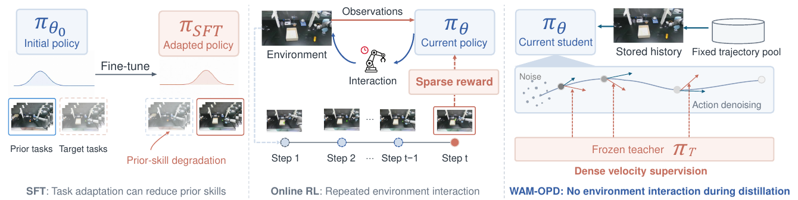
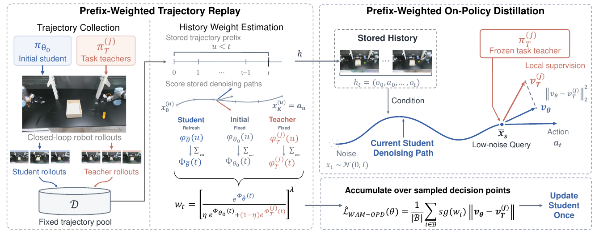

<div align="center">

<picture>
  <source media="(max-width: 600px)" srcset="assets/title-mobile.svg">
  
</picture>

Panjun&nbsp;Liu · Xiaohan&nbsp;Lei · Shiqi&nbsp;Zhang · Yikun&nbsp;Wang<br>
Yongxin&nbsp;Zhang · Mingyi&nbsp;Hu · Shida&nbsp;Sun · Jiateng&nbsp;Shou<br>
Wengang&nbsp;Zhou · Jiajun&nbsp;Deng<sup>✉</sup> · Zhiwei&nbsp;Xiong

**中国科学技术大学**<br>
<sub>✉ 通讯作者</sub>

<a href="https://arxiv.org/abs/2609.34250v1"></a>&nbsp;
<a href="https://pjliu3.github.io/wam-opd-project/"></a>&nbsp;
<a href="#引用"></a>&nbsp;
<a href="LICENSE"></a>

[概述](#概述) · [方法](#方法) · [实验结果](#实验结果) · [快速开始](#快速开始)<br>
[English](README.md) / [简体中文](README.zh-CN.md)

**固定轨迹池 + 当前学生查询 + 教师监督，实现世界动作模型的任务适配。**<br>
蒸馏过程中无需新增环境轨迹。

</div>

<p align="center">
  
</p>

## 概述

**WAM-OPD** 旨在提高预训练世界动作模型的目标任务表现，同时保留已有的操作技能。
核心方法 **前缀加权轨迹回放（Prefix-Weighted Trajectory Replay，PWTR）** 将存储的
观测历史、当前学生生成的新查询与冻结任务教师的监督结合起来。

本仓库提供 **混合轨迹池 + PWTR** 的实现，包含训练、权重导出、模型推理与评测工具。
源码包包含代码、方法文档和论文图片；训练与评测 bundle、模型权重、轨迹记录及特征缓存由用户在本地提供。

| 固定轨迹池 | 当前学生查询 | 前缀加权更新 |
|:---|:---|:---|
| 复用初始学生与任务教师采集的轨迹。 | 在已存储历史上生成新的学生去噪路径。 | 根据先前采样点的兼容性分数，对各决策的蒸馏损失加权。 |

## 方法

<p align="center">
  
</p>
<p align="center"><sub>WAM-OPD 方法框架 · 论文 Figure 2</sub></p>

1. **一次采集，持续回放。** 用初始学生和任务教师构建固定混合池。每条轨迹等间隔选取
   最多 16 个决策点；不足 16 点的短轨迹全部保留。
2. **估计前缀兼容性。** 用定期刷新的学生快照与两个固定参考模型对存储的去噪路径评分，累计先前
   采样点的分数，再对权重归一化、截断并重新归一化。
3. **在新查询上蒸馏。** 在回放历史上生成当前学生的去噪查询，由冻结任务教师提供速度
   监督。计算加权损失，每条轨迹执行一次学生更新。

当前决策不计入自身前缀，教师目标与权重不参与反向传播。评分公式、权重计算及实现细节
见[方法文档](docs/METHOD.md)。

## 实验结果

**论文 Table 1 汇报的仿真结果。** 成功率单位为 %。同一个适配后模型用于两个目标任务
以及六个未参与适配的技能保持任务。

| 方法 | Move Stapler Pad | Open Microwave | 目标任务平均 | 技能保持平均 |
|:---|---:|---:|---:|---:|
| **WAM-OPD（PWTR）** | **80.50** | **59.00** | **69.75** | **86.92** |

论文同时包含真实机器人实验。机器人演示见[项目主页](https://pjliu3.github.io/wam-opd-project/)，
完整实验结果见[论文](https://arxiv.org/abs/2609.34250v1)。

## 快速开始

### 1. 安装

在仓库根目录执行。CPU 工具支持 Python 3.10+；模型运行环境使用 Python 3.11 与 PyTorch 2.7.1。

```bash
python -m pip install -e '.[eval,test]'
wam-pwtr verify-release
python -m pytest -q
```

模型训练与环境评测还需要安装兼容的 FastWAM、RoboTwin 及其外部资产。
本地输入目录格式见[数据文档](docs/DATA.md)。

### 2. 检查本地训练 bundle

`--training-root` 直接包含 `assets.json`、`pool.json`、`reference_scores.json`
和 `schedule.json`；`--asset-root` 保存这些清单引用的模型及轨迹二进制文件。

```bash
wam-pwtr preview --training-root /path/to/training-bundle
wam-pwtr doctor \
  --training-root /path/to/training-bundle \
  --asset-root /path/to/assets --purpose train --hash-files
```

`preview` 在不加载模型的情况下核对采样日程。输入和缓存需在本地准备，命令不会自动下载。

### 3. 训练 PWTR

```bash
CUDA_VISIBLE_DEVICES=0,1 FASTWAM_OPD_FP32_ROPE=0 \
  wam-pwtr train \
  --training-root /path/to/training-bundle \
  --asset-root /path/to/assets \
  --fastwam-root /path/to/FastWAM \
  --output /path/to/runs/pwtr-u96
```

固定配方使用 **120 条混合轨迹**、**96 次更新**，每 **24 次更新**刷新权重，需要两张 GPU。
超参数、查询账本和资源要求见[训练文档](docs/TRAINING.md)。

### 4. 保存历史上的推理

```bash
CUDA_VISIBLE_DEVICES=0 wam-pwtr infer-record \
  --training-root /path/to/training-bundle \
  --asset-root /path/to/assets \
  --fastwam-root /path/to/FastWAM \
  --record-id RECORD_ID \
  --seed 0 \
  --output /path/to/prediction.pt
```

此入口使用本地资产清单中 `pwtr_u96` 标识的权重，对保存的历史输出归一化动作 latent。
机器人执行还需要动作反归一化、观测反馈与重规划。

### 5. 在 RoboTwin 中测试权重

提供本地[评测 bundle](docs/EVALUATION.md)和文本上下文缓存：

```bash
python test.py \
  --evaluation-root /path/to/evaluation-bundle \
  --checkpoint /path/to/model_weights.pt \
  --fastwam-root /path/to/FastWAM \
  --robotwin-root /path/to/RoboTwin \
  --text-cache /path/to/text_cache \
  --gpu 0 \
  --output /path/to/evaluation/pwtr-u96
```

该命令加载指定权重，执行本地 bundle 中的 400 场评测（两任务 × 两条件 × 100 场景）。
添加 `--check-only` 可在不创建模型或仿真场景的情况下检查依赖与资产。任务和条件选择方式见[评测文档](docs/EVALUATION.md)。

新结果保存在指定输出目录的 `summary.json`、`summary.csv` 与 `outcomes.jsonl`。
源码包不附带评测场景、已记录结果或文本特征缓存。

## 文档

| 文档 | 内容 |
|:---|:---|
| [方法](docs/METHOD.md) | 采样前缀、兼容性评分与蒸馏损失 |
| [训练](docs/TRAINING.md) | 固定配方、资源要求与检查点 |
| [本地 bundle](docs/DATA.md) | 元数据、模型及轨迹输入 |
| [评测](docs/EVALUATION.md) | 使用本地 RoboTwin 面板测试权重 |
| [验证](docs/VALIDATION.md) | 使用合成数据的 CPU 测试 |

<details>
<summary><b>仓库结构</b></summary>

```text
test.py            RoboTwin 闭环任务评测
src/wam_pwtr/      PWTR 命令、训练、推理与评测
src/wam_opd_v2/    训练循环、优化器与检查点验证
src/fastwam_opd/   FastWAM 模型与记录接口
configs/           方法及环境配置
assets/            论文图片及 README 图形
tests/             使用合成数据的 CPU 测试
tools/             本地资产工具
provenance/        源码及外部运行时指纹
```

</details>

## 引用

如果本工作对你的研究有帮助，欢迎引用：

```bibtex
@misc{liu2026wamopd,
  title = {{WAM-OPD}: Sharpening World Action Models via On-Policy Distillation},
  author = {Liu, Panjun and Lei, Xiaohan and Zhang, Shiqi and Wang, Yikun
            and Zhang, Yongxin and Hu, Mingyi and Sun, Shida and Shou, Jiateng
            and Zhou, Wengang and Deng, Jiajun and Xiong, Zhiwei},
  year = {2026},
  eprint = {2609.34250},
  archivePrefix = {arXiv},
  primaryClass = {cs.RO},
  url = {https://arxiv.org/abs/2609.34250}
}
```

## 许可证

项目代码使用 [MIT 许可证](LICENSE)。第三方库、预训练模型与任务资产保留各自许可证，
详见[第三方依赖说明](THIRD_PARTY_NOTICES.md)。
